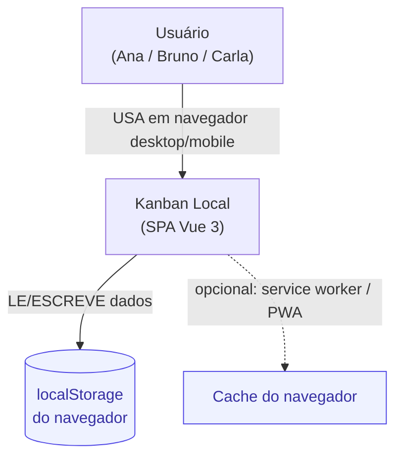
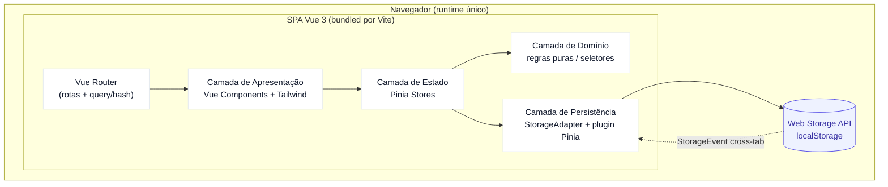
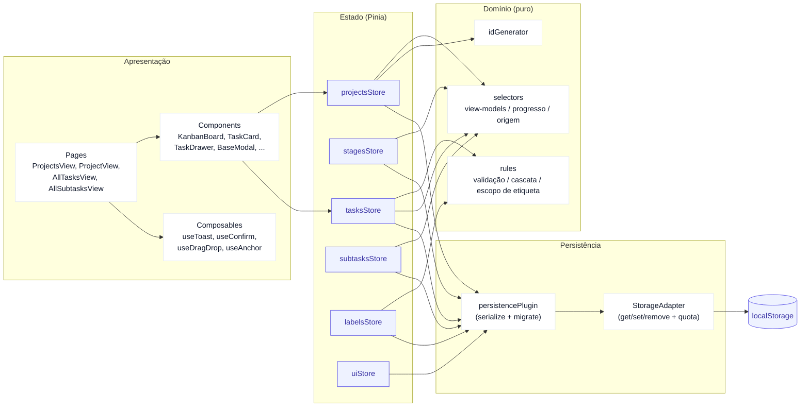
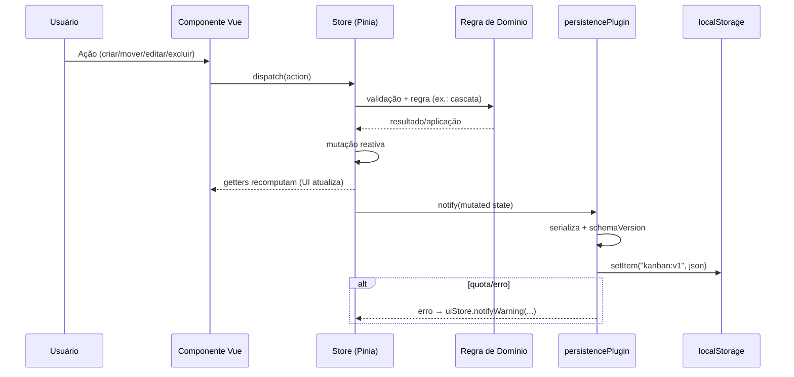
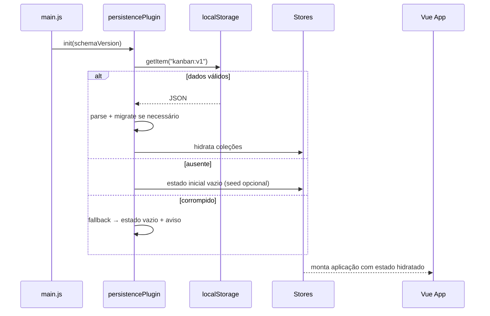
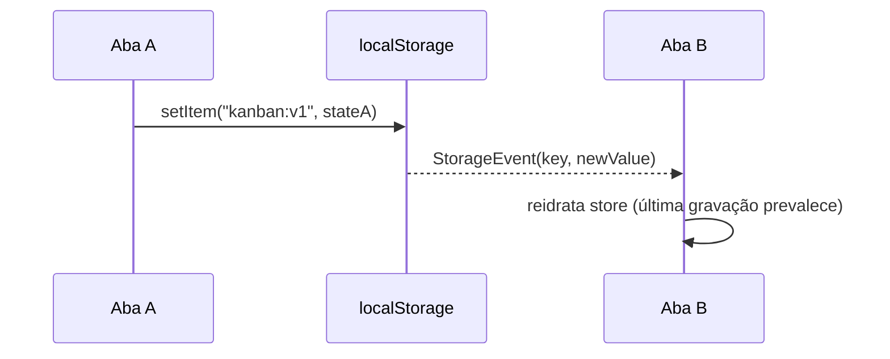
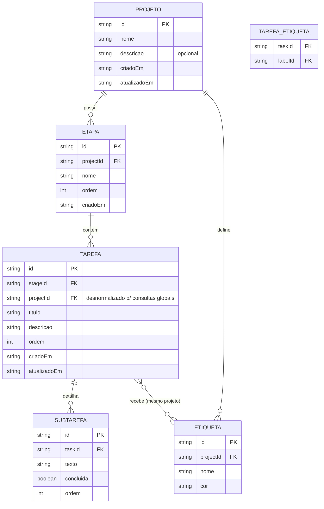
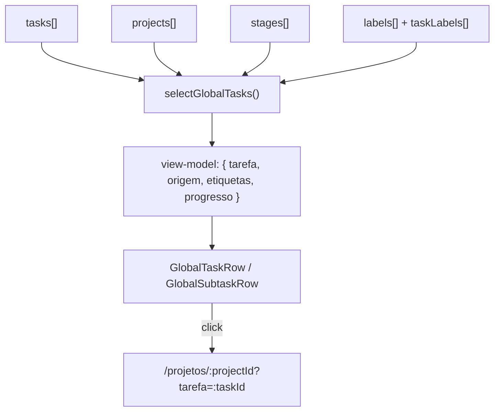

# Arquitetura do Sistema — Kanban Local

**Agente:** Arquiteto de Software
**Data:** 2026-10-15
**Documento:** `architecture-diagram.md`
**Insumos:** `outputs/product-owner/*.md` (requisitos, user stories, backlog, critérios de aceitação) · `outputs/ux/design-system.md` · `outputs/ux/wireframes/`
**Restrições herdadas:** SPA 100% client-side · Vue 3 + Pinia + Tailwind CSS · persistência exclusiva em `localStorage` · single-user / single-device · sem backend.

---

## 1. Visão Geral

O sistema é uma **Single Page Application (SPA)** executada inteiramente no navegador. Não há backend, banco de dados remoto, autenticação ou chamadas de rede de negócio. Todo o estado vive em memória (Pinia) e é persistido de forma síncrona/assíncrona na `localStorage` do navegador.

### 1.1 Princípios arquiteturais

| # | Princípio | Implicação prática |
|---|-----------|--------------------|
| P-01 | **Local-first** | A fonte de verdade é o estado em memória; a `localStorage` é um espelho durável. |
| P-02 | **Camada única de persistência** | Nenhum componente/store acessa `localStorage` diretamente; tudo passa por um adapter. |
| P-03 | **Modelo normalizado** | Entidades em coleções indexadas por `id`; relações por referência de id (sem duplicação). |
| P-04 | **Fluxo unidirecional** | Componente → action da store → mutação → getter reativo → UI. |
| P-05 | **Acessibilidade por padrão** | Alvos ≥ 40px, foco visível, teclado em todos os fluxos (H-10/A-10 do UX). |
| P-06 | **Design system como contrato** | Tokens e componentes do `design-system.md` são a interface entre UX e dev. |
| P-07 | **Evolução versionada** | Esquema persistido com `schemaVersion` e migrações (chave `kanban:v1`). |

### 1.2 Requisitos arquiteturais (NFRs)

| NFR | Meta | Origem |
|-----|------|--------|
| Persistência confiável | Estado idêntico após reload | US-23 / CA-US-23 |
| Gravação | ≤ 16ms por mutação (não bloquear a UI) | UX (feedback imediato) |
| Renderização | Interação fluida com centenas de tarefas | US-17 / A-09 |
| Resiliência de storage | Quota excedida / storage indisponível → modo degradado sem crash | CA-US-23 |
| Acessibilidade | WCAG 2.1 AA (contraste, foco, teclado, alvos) | US-22 / §4 design-system |
| Consistência multia| Última gravação prevalece entre abas | CA-US-02/US-08 |
| Navegação | Global → tarefa em 1 clique | US-19 / US-21 |

---

## 2. Diagramas de Arquitetura

### 2.1 C4 — Nível 1: Contexto



**Integrações externas:** nenhuma. As únicas dependências de plataforma são as Web APIs do navegador (`localStorage`, `crypto`, `StorageEvent`, `History API`).

### 2.2 C4 — Nível 2: Containers



### 2.3 C4 — Nível 3: Componentes (camadas internas)



---

## 3. Camadas e Responsabilidades

| Camada | Responsabilidade | Não faz | Artefatos |
|--------|------------------|---------|-----------|
| **Apresentação** | Renderizar, capturar intenção do usuário, feedback (toast/erro), acessibilidade | Regra de negócio, acesso a storage | `src/pages`, `src/components`, `src/composables` |
| **Estado (Pinia)** | Orquestrar actions, manter coleções reativas, expor getters | Serialização, DOM | `src/stores/*` |
| **Domínio** | Regras puras e seletores testáveis, sem dependência de Vue | Efeitos colaterais, I/O | `src/domain/*` |
| **Persistência** | Serializar/deserializar, versionar, tratar quota/erro, sync cross-tab | Regra de negócio | `src/persistence/*` |

**Regra de dependência:** as setas só apontam para dentro (Apresentação → Estado → Domínio; Estado → Persistência). O Domínio não conhece Pinia nem o navegador.

---

## 4. Fluxo de Dados

### 4.1 Escrita (write path)



**Característica:** a UI atualiza **antes** da persistência (otimista). A persistência é desacoplada via subscriber do plugin; falha de escrita não corrompe o estado em memória e gera aviso (US-23).

### 4.2 Leitura (read path / bootstrap)



### 4.3 Sincronização entre abas (opcional, MVP+)



Regra adotada: **última gravação prevalece** (CA US-02/US-08). Sem merge automático no MVP.

---

## 5. Roteamento e Navegação

Referência direta ao sitemap do `wireframes/index.md` §1.

| Rota | View | Query/State | Stories |
|------|------|-------------|---------|
| `/` | `ProjectsView` | — | US-01, US-03, US-04 |
| `/projetos/:projectId` | `ProjectView` (Kanban ⇄ Lista) | `?view=kanban\|lista` (persistido) | US-05…US-11, US-15, US-16 |
| `/projetos/:projectId?tarefa=:taskId` | `ProjectView` + `TaskDrawer` | abre tarefa em foco | US-19 |
| `/projetos/:projectId?tarefa=:taskId#sub-:subtaskId` | `ProjectView` + drawer + âncora | foco + destaque da subtarefa | US-21 |
| `/tarefas` | `AllTasksView` | `?q=termo` | US-17, US-18, US-19 |
| `/subtarefas` | `AllSubtasksView` | `?q=termo` | US-20, US-21 |
| `/:pathMatch(.*)*` | `NotFoundView` | — | fallback amigável |

**Regras de navegação:**
- Alternância Kanban ↔ Lista **não** perde contexto (preserva `projectId`, filtros e scroll) — RF-11/US-11.
- Rotas globais carregam estado em **query** (`q`, `tarefa`) para permitir deep-linking e botão voltar.

---

## 6. Modelo de Dados

### 6.1 ERD lógico (normalizado por id)



**Notas de modelagem:**
- `TAREFA.projectId` é **desnormalizado** (além de `stageId`) para permitir as visões globais (`/tarefas`, `/subtarefas`) e os seletores de origem sem joins custosos — mantido consistente por regra no `tasksStore`.
- Relação etiqueta↔tarefa **N↔N** restrita ao mesmo projeto (RN-04) é garantida por validação na camada de Domínio.
- `ordem` em etapa/tarefa/subtarefa habilita ordenação estável (Could: reordenação manual).

### 6.2 Envelope de persistência (versionado)

```jsonc
{
  "schemaVersion": 1,
  "savedAt": "2026-10-15T12:00:00.000Z",
  "data": {
    "projects":   [ /* Projeto[] */ ],
    "stages":     [ /* Etapa[]   */ ],
    "tasks":      [ /* Tarefa[]  */ ],
    "subtasks":   [ /* Subtarefa[] */ ],
    "labels":     [ /* Etiqueta[] */ ],
    "taskLabels": [ /* { taskId, labelId }[] */ ]
  },
  "meta": { "updatedBy": "tab-<uuid>", "appVersion": "0.1.0" }
}
```

Uma única chave raiz `kanban:v1` (ou uma chave por coleção `kanban:v1:projects`, etc.). A decisão está em **ADR-005**.

### 6.3 Regras de integridade (de `requirements.md`)

| ID | Regra | Onde é garantida |
|----|-------|------------------|
| RN-01 | Nome de projeto obrigatório; descrição opcional | Domínio (`rules`) + validação de UI |
| RN-02 | Tarefa pertence a exatamente 1 etapa; etapa a 1 projeto | Modelo + `tasksStore` |
| RN-03 | Subtarefa pertence a 1 tarefa; `concluida` booleano | Modelo |
| RN-04 | Etiqueta N↔N apenas no mesmo projeto; remover etiqueta desvincula | Domínio (`rules`) + cascata |
| RN-05 | Filtro de nome case-insensitive, parcial | Seletores (`selectors`) |
| Cascata | Excluir projeto remove filhos; excluir tarefa remove subtarefas; **excluir etapa com tarefas é bloqueado** | Domínio (`rules`) |

---

## 7. Persistência e Ciclo de Vida

| Aspecto | Decisão |
|---------|---------|
| Chave | `kanban:v1` (+ `schemaVersion` no envelope) |
| Serialização | `JSON.stringify`/`parse` com `try/catch` |
| Estratégia de gravação | Debounce (ex.: 150ms) para agrupar mutações rápidas; flush no `beforeunload` |
| Quota excedida | `QuotaExceededError` → aviso persistente + mantém estado em memória |
| Storage indisponível | Detecção no boot (modo privado) → aviso + modo degradado |
| Corrupção | Parse falho → estado vazio + aviso; nunca crash |
| Cross-tab | `StorageEvent` reidrata (última gravação prevalece) |
| Migração | `migrate(oldVersion → newVersion)` executado no boot |

Detalhamento nas **ADRs 005, 006 e 011**.

---

## 8. Integrações (Web APIs)

| API | Uso | Fallback |
|-----|-----|----------|
| `localStorage` | Persistência local | Modo degradado em memória + aviso |
| `crypto.randomUUID()` | Geração de ids | `nanoid`-like via `crypto.getRandomValues` |
| `StorageEvent` | Sync entre abas | Ignorado se indisponível |
| History API (Vue Router) | Navegação/deep-link | Hash mode se hospedado sem rewrite |
| `navigator.clipboard` (Could) | Copiar/exportar JSON | — |

Não há integração de rede (sem API de terceiros, calendário, e-mail — fora de escopo MVP).

---

## 9. Navegação de Dados em Consultas Globais

`/tarefas` e `/subtarefas` percorrem coleções normalizadas e compõem view-models com **origem visível** (`projeto › etapa`), atendendo A-07.



---

## 10. Segurança e Privacidade

- **Sem segredos** no client. Nenhuma chave/credencial.
- Dados **locais por origem**; limpos pelo usuário ao limpar dados do site.
- **XSS:** evitar `v-html`; renderizar texto por interpolação (Vue escapa por padrão). Sanitizar qualquer entrada que venha a usar HTML (não previsto no MVP).
- **CSP** recomendada no host estático: `default-src 'self'`.
- Sem PII sensível prevista; mesmo assim, nenhuma telemetria é coletada.

---

## 11. Riscos Arquiteturais e Mitigações

| Risco | Prob. | Impacto | Mitigação |
|-------|:----:|:------:|-----------|
| Corrupção de dados no storage | Média | Alto | Envelope versionado + parse defensivo + fallback |
| Quota excedida | Média | Alto | Cliente de escrita com tratamento de erro + aviso |
| Crescimento do JSON único | Média | Médio | Debounce + possibilidade de chave por coleção (evolução) |
| Regressão de performance em listas grandes | Baixa | Médio | Seletores memoizados + virtualização vista como "Could" |
| Divergência entre abas | Média | Médio | `StorageEvent` + regra "última gravação prevalece" |
| Acoplamento UI ↔ storage | Baixa | Alto | Proibido acesso direto; lint/regra de revisão (P-02) |

---

## 12. Rastreabilidade Requisitos → Arquitetura

| Funcionalidade (PO) | Componentes/Decisões de arquitetura |
|---------------------|--------------------------------------|
| F-01…F-05 (CRUDs) | Stores por entidade + regras de Domínio + persistência |
| F-06/F-07 (Kanban/Lista) | `ProjectView` + `?view=` preservando contexto |
| F-08/F-09 (visões globais) | Seletores globais + desnormalização `task.projectId` |
| F-10 (navegação global→projeto) | Rotas com `?tarefa=`/`#sub-` + `useAnchor` |
| F-11 (UI profissional) | Design system como contrato + Tailwind tokens |
| US-23 (persistência) | `persistencePlugin` + `StorageAdapter` |
| US-22 (a11y) | Padrões WCAG AA no desenvolvimento-guidelines §Acessibilidade |

---

**Documentos relacionados:** `tech-stack.md` · `design-patterns.md` · `development-guidelines.md` · `adr/`
